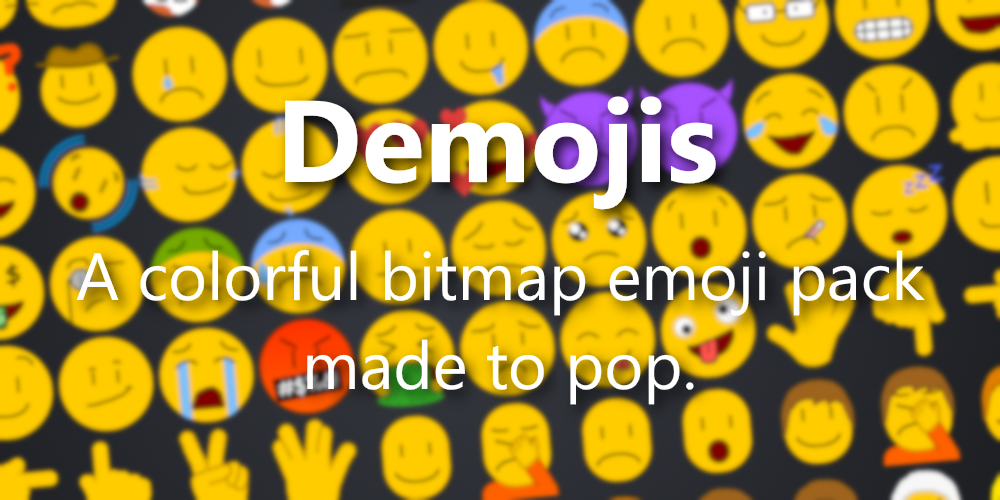

Demojis is a bitmap emoji pack with many emojis across various categories. Each emoji comes in four sizes, and you can load them from a CDN or install the package and serve them yourself.

## Installation

```bash
npm install demojis
```

## Usage

Showing an emoji takes four steps.

1. **Install the package:** You can skip this and use the CDN instead (see [Plain HTML](#plain-html)).

   ```bash
   npm install demojis
   ```

2. **Find the name you need:** Names are compound words like `smile`, `cat`, `star`, and `heartred`. You can list every name or browse by category:

   ```javascript
   import demojis from "demojis";

   demojis.all; // every name (sorted alphabetically)
   demojis.getCategories(); // ["animals", "faces", "hands", "people", "symbols"]
   demojis.getByCategory("faces"); // ["angry", "baffled", ..., "smile", ...]
   ```

3. **Get the image URL:** Pass a name, and you can optionally pass a size: `32`, `64`, `128`, or `256`.

   ```javascript
   demojis.getImage("smile", 64);
   ```

4. **Display tjhe emoji:** Use the URL as the `src` of an ``, and set `alt` to the emoji name.

   ```javascript
   const img = document.createElement("img");
   img.src = demojis.getImage("smile", 64);
   img.alt = "smile";
   img.width = img.height = 32;
   document.body.append(img);
   ```

### Plain HTML

If you don't want to install anything, point an `` at the CDN. You might want to pin the version so your page doesn't change when a new release comes out.

```html

```

The URL follows this pattern: `https://cdn.jsdelivr.net/npm/demojis@<version>/dist/images/<size>/<name>.png`.

### React / Preact

Wrap the image in a small component so you only pass a name:

```jsx
import demojis from "demojis";

export function Emoji({ name, px = 24, ...rest }) {
  return (
    
  );
}

// <Emoji name="cat" px={32} />
```

### Scaling

Smooth scaling makes Demojis look blurry. Turn smoothing off with `image-rendering: pixelated` and choose a source size at least as large as the size you display.

```css
.emoji {
  width: 1.25em;
  height: 1.25em;
  vertical-align: -0.25em;
  image-rendering: pixelated;
}
```

### Self-hosting

To serve the images from your own site, copy them into your public folder:

```bash
cp -r node_modules/demojis/dist/images public/demojis
```

Then tell `getImage` where they live. In Vite, the `public` folder is served from the site root:

```javascript
import demojis from "demojis";

demojis.setBaseUrl("/demojis");

demojis.getImage("smile", 64); // "/demojis/64/smile.png"
```

## Image sizes

Four sizes are available: `32`, `64`, `128`, and `256` pixels. All images are PNG files.

## API

### `demojis.all`

An array of every emoji name sorted alphabetically.

### `demojis.categories`

An object that maps each category name to its list of emoji names.

```javascript
{
  faces: ["smile", "zany", ...],
  symbols: ["x", "checkmark", ...],
  ...
}
```

### `getAll()`

Returns `demojis.all`.

### `getCategories()`

Returns the category names as an array of strings.

### `getByCategory(name)`

Returns the emoji names in a category. If the category doesn't exist, it returns `[]`.

### `getRandom(category?)`

Returns a random emoji name. Pass a category name to pick only from that category. Returns `null` if the category is empty or doesn't exist.

### `getImage(name, size?)`

Returns the URL of an emoji image. The default size is `256` pixels.

- **Node (ESM/CJS):** it returns a `file://` URL that points to the image inside `node_modules`. Browsers can't load these, so for server-rendered pages, use the CDN URL or self-host the images.
- **The browser (Vite, webpack, etc.):** it returns a jsDelivr CDN URL.

### `setBaseUrl(url)` _(browser only)_

Changes the base URL that `getImage` uses. Trailing slashes are removed automatically.

## Module formats

| Condition | File              | Use case                          |
| --------- | ----------------- | --------------------------------- |
| `browser` | `dist/browser.js` | Vite, webpack, and other bundlers |
| `import`  | `dist/index.js`   | Node ESM (`import`)               |
| `require` | `dist/index.cjs`  | Node CJS (`require`)              |

## Unicode equivalents

If you need the Unicode equivalent of each Demojis emoji, see [UNICODE.md](UNICODE.md).
